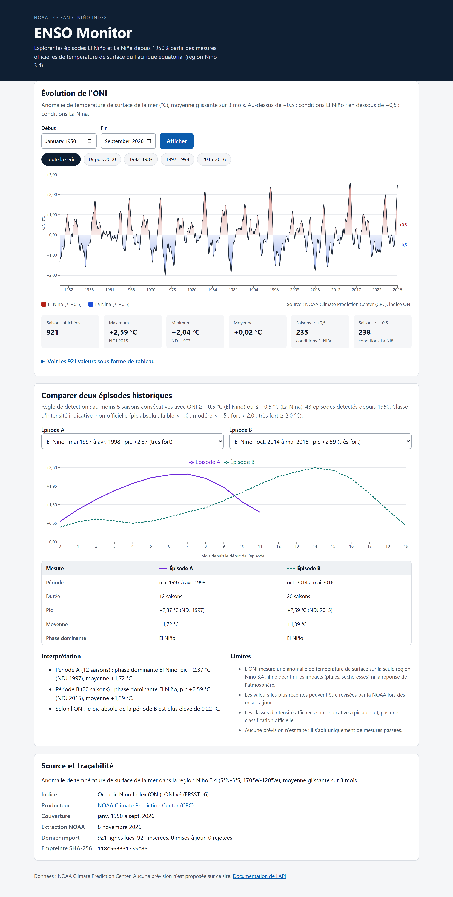

# ENSO Monitor

Application web d'exploration de l'**Oceanic Niño Index (ONI)** publié par la NOAA :
courbe interactive filtrable par période, détection des épisodes El Niño / La Niña
et comparaison chiffrée de deux épisodes historiques, avec une interprétation prudente.

Projet de rattrapage HETIC WEB3 (RNCP 36146). Le dossier de conception est dans `docs/`.



## Fonctionnalités (MVP)

| Exigence du sujet | Réalisation |
| --- | --- |
| Importer une série NOAA authentique dans PostgreSQL avec Python, identifier la source, contrôler les doublons | ETL `backend/etl/` (pandas) : contrôle de format, rejet des lignes invalides, dédoublonnage, contrainte `UNIQUE (index_id, period)` en base, table `data_import` (empreinte SHA-256, volumes, date d'extraction) |
| API FastAPI documentée, filtrage temporel, validation des entrées | `/api/v1/...`, validation Pydantic + format `AAAA-MM`, codes 404/422, OpenAPI sur `/api/docs` |
| Courbe interactive React/TypeScript avec filtre de période | Graphique Recharts, sélecteur de mois + périodes prédéfinies, statistiques recalculées, tableau accessible |
| Comparer deux épisodes historiques avec une interprétation prudente | Détection selon la règle NOAA (5 saisons ≥ +0,5 / ≤ −0,5), courbes superposées, tableau comparatif, interprétation et limites |

## Stack

| Couche | Technologies |
| --- | --- |
| Frontend | React 19, TypeScript (strict), Vite, Recharts |
| API | Python 3.12, FastAPI, Pydantic |
| Données | PostgreSQL 17, SQLAlchemy 2, Alembic |
| ETL | Python, pandas, NumPy |
| Tests | Pytest, Vitest + Testing Library |
| Exécution | Docker Compose, Caddy (reverse proxy) |

## Lancement rapide (Docker)

Prérequis : Docker Desktop (ou Docker Engine + Compose v2).

```bash
cp .env.example .env          # puis choisir un mot de passe PostgreSQL
docker compose up -d --build
```

Ouvrir http://localhost:8080. La documentation de l'API est sur http://localhost:8080/api/docs.

Au démarrage :

1. `db` démarre PostgreSQL (volume persistant `pgdata`) ;
2. `api` applique les migrations Alembic puis lance FastAPI ;
3. `etl` importe l'instantané NOAA versionné (`data/raw/oni.ascii.txt`) puis s'arrête ;
4. `web` (Caddy) sert le frontend compilé et relaie `/api/*` vers FastAPI.

Seul le port 8080 est exposé. La base et l'API ne sont joignables que par les réseaux Docker internes.

Commandes utiles :

```bash
docker compose ps                                              # état des services
docker compose logs -f api                                     # journaux de l'API
docker compose run --rm etl                                    # relancer l'import (idempotent)
docker compose run --rm etl python -m etl.import_oni --download  # récupérer la dernière version NOAA
docker compose down                                            # arrêter (les données restent)
docker compose down -v                                         # arrêter et supprimer les volumes
```

## Variables d'environnement

| Variable | Rôle | Exemple |
| --- | --- | --- |
| `POSTGRES_USER` | Utilisateur PostgreSQL | `enso` |
| `POSTGRES_PASSWORD` | Mot de passe PostgreSQL (obligatoire, jamais versionné) | valeur aléatoire |
| `POSTGRES_DB` | Nom de la base | `enso` |
| `WEB_PORT` | Port local de l'application | `8080` |
| `SITE_ADDRESS` | Production : nom de domaine (HTTPS automatique par Caddy) | `enso.example.org` |

`DATABASE_URL` est construite par Compose pour l'API et l'ETL. L'application refuse de démarrer si elle est absente.

## Développement local

### Backend

```bash
cd backend
python -m venv .venv
.venv/Scripts/activate          # Windows ; source .venv/bin/activate sous Linux/macOS
pip install -r requirements-dev.txt
pytest                          # tests (base SQLite en mémoire, aucun service requis)
ruff check . && ruff format --check .
```

### Frontend

```bash
cd frontend
npm ci
npm run dev        # http://localhost:5173, /api relayé vers la pile Docker (localhost:8080)
npm test           # Vitest
npm run lint       # oxlint
npm run build      # vérification TypeScript + build de production
```

`VITE_API_TARGET` permet de relayer `/api` vers une autre adresse en développement.

## Données

| Élément | Valeur |
| --- | --- |
| Indice | ONI (Oceanic Niño Index), anomalie de température de surface de la mer en région Niño 3.4, moyenne glissante sur 3 mois |
| Producteur | NOAA Climate Prediction Center |
| Page de référence | https://www.cpc.ncep.noaa.gov/products/analysis_monitoring/enso/oni/v6/index.php |
| Fichier | https://www.cpc.ncep.noaa.gov/data/indices/oni.ascii.txt |
| Version | ONI v6 (ERSST.v6) |
| Date d'extraction | 8 novembre 2026 (fichier modifié par la NOAA le 3 novembre 2026) |
| Couverture | DJF 1950 à ASO 2026, 921 saisons |
| Empreinte SHA-256 | `118c563331335c8649cdc2677e6be7ae89d1259d901345fcddbc2857af280f7f` |

L'instantané et ses métadonnées sont versionnés dans `data/raw/` pour que l'import soit reproductible.
Chaque saison (ex. `DJF 1998` = déc. 1997, janv. et févr. 1998) est rattachée à son mois central (`1998-01-01`).

**Règle de détection des épisodes** (définition opérationnelle de la NOAA) : au moins 5 saisons consécutives
avec ONI ≥ +0,5 °C (El Niño) ou ≤ −0,5 °C (La Niña). La classe d'intensité (faible, modéré, fort, très fort selon
le pic absolu : seuils 1,0 / 1,5 / 2,0 °C) est indicative et non officielle. L'expression « Super El Niño »
n'est pas utilisée. Aucune prévision n'est produite.

## API

| Méthode et route | Description |
| --- | --- |
| `GET /api/v1/health` | État de l'API et de la base |
| `GET /api/v1/indices` | Indices disponibles, source, couverture, dernier import |
| `GET /api/v1/indices/{code}/observations?start=AAAA-MM&end=AAAA-MM` | Observations filtrées (bornes incluses, facultatives) |
| `GET /api/v1/indices/{code}/episodes?kind=el_nino\|la_nina` | Épisodes détectés |
| `GET /api/v1/indices/{code}/compare?a_start=&a_end=&b_start=&b_end=` | Comparaison de deux périodes (120 mois max chacune) |

Erreurs : `404` indice inconnu ou période vide, `422` paramètre invalide (format de mois, début postérieur à la fin, période trop longue).

## Tests

| Test minimal demandé | Fichier | Ce qui est vérifié |
| --- | --- | --- |
| Données : transformation Python | `backend/tests/test_transform.py` | doublons (dernière occurrence conservée), saison/année/valeur invalides rejetées, calcul du mois central |
| API : route filtrée par période | `backend/tests/test_api.py` | réponse attendue sur `2000-06..2000-08`, formats invalides et période inversée → `422`, indice inconnu → `404` |
| Frontend : changement de période | `frontend/src/App.test.tsx` | un changement de période rappelle l'API et met à jour les valeurs affichées ; période inversée refusée ; erreur réseau affichée |

S'y ajoutent `test_etl.py` (import idempotent, révision NOAA mise à jour et tracée) et `test_episodes.py` (règle des 5 saisons, coupure de série, épisode en cours, pics trop proches non départagés).

Résultats au 8 novembre 2026 : **22 tests Pytest** et **3 tests Vitest** passent ; `ruff`, `oxlint` et `tsc` sans erreur.

## Structure

```
enso-monitor/
├── backend/
│   ├── app/                FastAPI : config, modèles, schémas, routes, service d'épisodes
│   ├── etl/                transform.py (fonctions pures) et import_oni.py (chargement)
│   ├── alembic/            migrations du schéma
│   └── tests/
├── frontend/
│   └── src/                api/ (client typé), components/, hooks/, App.tsx
├── data/raw/               instantané NOAA et métadonnées d'extraction
├── deploy/Caddyfile        reverse proxy (local et production)
├── compose.yaml            pile locale
├── compose.prod.yaml       surcharge pour un VPS (ports 80/443)
└── docs/                   PDF (dossier de conception, guide de soutenance) et leurs sources HTML
    └── tools/              génération : npm ci, puis node build-pdf.mjs et node screenshots.mjs
```

## Sécurité

- Secrets uniquement dans `.env` (ignoré par Git) ; aucune valeur par défaut pour `DATABASE_URL`.
- Requêtes SQL paramétrées via SQLAlchemy ; entrées validées par Pydantic et par expression régulière.
- API en lecture seule : pas d'écriture exposée, donc pas d'administration à protéger.
- Base de données non exposée, conteneur API exécuté sans privilèges root.
- En-têtes de sécurité et Content-Security-Policy posés par Caddy ; HTTPS automatique en production.

## Déploiement

Le déploiement cible (VPS Linux, Docker Compose, Caddy, sauvegardes) est décrit dans le dossier de conception
(section 7). Version courte :

```bash
# sur le VPS, avec SITE_ADDRESS=enso.example.org dans .env
docker compose -f compose.yaml -f compose.prod.yaml up -d --build
```
